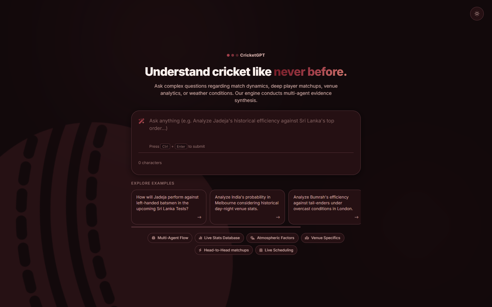
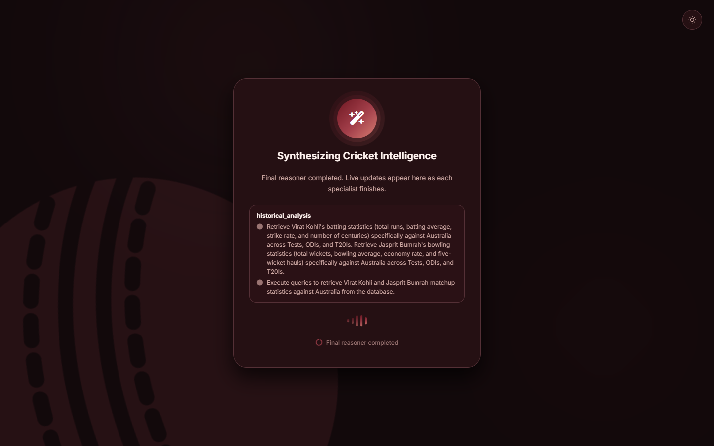
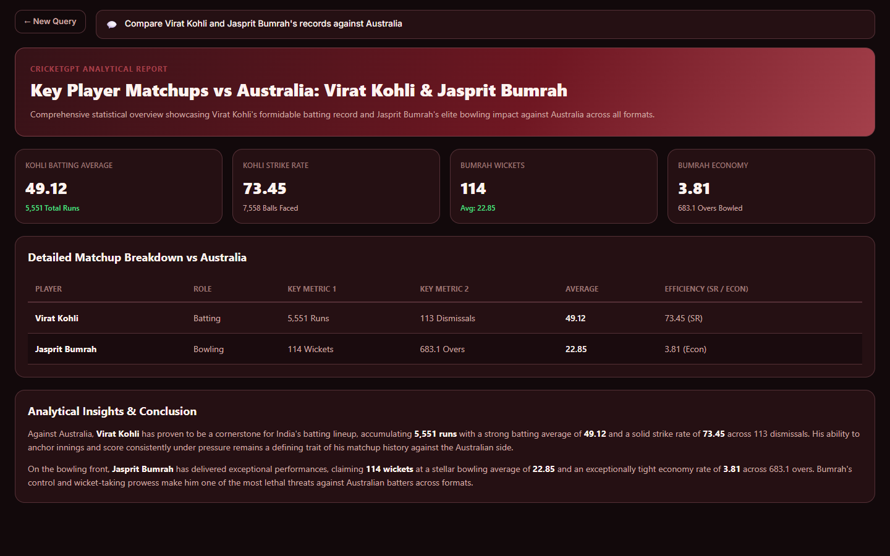

# CricketGPT

CricketGPT is an AI-assisted cricket research and match-analysis application. It turns a natural-language question into a focused evidence-gathering workflow, retrieves structured cricket data, and presents an explainable answer through a web UI.

It is designed for questions that are difficult to answer with one lookup: for example, assessing an upcoming match, comparing players, investigating batter-versus-bowler records, examining pitch behaviour, or checking availability news.

## What it does

- Accepts questions such as *“What are India’s chances against Australia in the next Test?”* or *“How has a batter performed against a particular bowler?”*
- Builds the minimum set of research steps needed for the question.
- Combines fixture and squad context, historical MongoDB statistics, venue conditions, weather, and recent news where relevant.
- Produces a written analysis and presentation-ready HTML, including prediction, win probabilities, evidence, and a verdict when the request is predictive.
- Streams workflow progress to the browser so users can see which analysis stage is running.

## Screenshots

| Home | Live agent progress | Result |
| --- | --- | --- |
|  |  |  |

*Query shown: "Compare Virat Kohli and Jasprit Bumrah's records against Australia".*

## Architecture

```text
User question
    ↓
Planner → Executor/router → specialised research agents
    ↓                         ↓
    └──────────────────→ MongoDB execution agent
                                ↓
                      Final reasoning agent
                                ↓
                       Presentation agent
                                ↓
                 FastAPI + SSE → Angular dashboard
```

The backend uses a LangGraph state machine. Every node reads and writes a shared `CricketState`, allowing the workflow to retain the original question, intent, plan, schedule context, generated query specifications, evidence, and final output.

## Agent design

The system deliberately separates planning, data-query construction, deterministic execution, reasoning, and rendering. Language models decide *what evidence is needed*; deterministic templates and database workers retrieve that evidence. This keeps database access structured rather than allowing free-form LLM-generated MongoDB pipelines.

| Agent | Responsibility | Inputs and outputs |
| --- | --- | --- |
| **Planner** | Classifies the request as historical analysis or prediction and creates an ordered, minimal plan. | Reads the user question; outputs intent and steps with the appropriate specialist agents. |
| **Executor / router** | Runs one planned step at a time and routes state to the next node. | Reads the current plan index; advances it and selects the next agent. |
| **Scheduler** | Resolves a series, upcoming/past fixtures, match details, venue, and squads. | Uses team names and tour data; outputs `schedule` context used by downstream agents. |
| **Player agent** | Converts player-statistics requests into structured template requests. | Supports career, recent form, format-specific, milestone-period, home/away, innings, and win/loss splits. |
| **Matchup agent** | Builds head-to-head requests and expands squad context into relevant batter–bowler comparisons when needed. | Supports batter vs bowler, player vs opposition, recent H2H, and team vs team analysis. |
| **Venue agent** | Identifies the target venue/city and chooses historical venue-analysis templates; can request weather for a date and place. | Covers scoring patterns, pitch/bowling conditions, and toss/outcome trends. |
| **Weather agent** | Executes weather requests after venue resolution. | Geocodes the city and retrieves forecast conditions including temperature, humidity, wind, rain chance, and precipitation. |
| **News agent** | Retrieves recent external updates only when availability information matters. | Generates focused DuckDuckGo News searches for injuries, fitness, squad selection, leave, and playing-XI updates. |
| **Mongo execution agent** | Executes only approved, template-based aggregation pipelines and collects their results. | Runs player, matchup, and venue templates against the local `cricket_db` database. |
| **Final reasoning agent** | Synthesizes the gathered evidence into an answer appropriate to the user’s intent. | Receives schedule, database results, weather, and news; outputs the final analysis. |
| **Presentation agent** | Converts the final analysis and raw evidence into safe display-oriented HTML. | Outputs `final_html` consumed by the Angular results screen. |

### Entity resolution (fuzzy name and venue matching)

Users write "Virat Kohli" or "Lord's"; the database stores Cricsheet names such as `V Kohli` or `SPD Smith`. Before any template runs, names are resolved with scored, approximate matching rather than exact lookups. Both resolvers log what they matched.

**Players** (`resolve_player` in `db.py`) use a tiered heuristic with a popularity prior:

1. **Candidate retrieval:** the surname must match the end of a stored name (regex, case-insensitive), searched in the given team's squad list or, if no team is known, across the 12 major Test nations.
2. **Tiered scoring** on the initials:
   - **Tier 1:** exact full-name match (`KL Rahul` → `KL Rahul`).
   - **Tier 2:** exact initials match (`Virat` → `V` → `V Kohli`).
   - **Tier 3:** the stored initials start with the requested ones (`Steve` → `S` → `SPD Smith`, `Jasprit` → `JJ Bumrah`). Requiring the same first letter stops `Axar` matching `PA Patel`.
3. **Frequency tie-breaker:** within the best tier, the candidate with the most matches played wins. This acts as a prior: the more established player is the more likely referent.

Each resolution reports its tier, e.g. `'Steve Smith' -> 'SPD Smith' (Australia) | Tier 3 Match | 356 matches played`. Unresolvable names return `not_found` instead of guessing.

**Venues** (`resolve_venue` in `db_workers/venue.py`) use semantic similarity: candidates are restricted to the match city, then ranked by cosine similarity between a `sentence-transformers` (`all-MiniLM-L6-v2`) embedding of the requested name and pre-computed venue embeddings. `Lords` resolves to `Lord's` (score 0.69) and `Wankhede` to `Wankhede Stadium` (0.75).

### Evidence-query templates

The MongoDB worker maps structured agent output to reusable aggregation templates:

- **Player templates (P1–P9):** recent performances, career summaries, format records, date-range milestones, home/away, innings splits, and results-based performance.
- **Matchup templates (M1–M5):** batter–bowler and bowler–batter records, player vs team, recent matchups, and team H2H.
- **Venue templates (V1–V3):** venue batting/scoring patterns, bowling/pitch trends, and toss/outcome patterns.

## Workflows it can handle

### 1. Historical player analysis

Example: *“Compare Virat Kohli and Rohit Sharma’s batting records.”*

```text
Planner → Player agent → Mongo execution → Final reasoning → Presentation
```

Useful for career comparisons, recent form, format-specific records, milestones, home/away results, and performance in wins or losses.

### 2. Player or team head-to-head analysis

Example: *“What is KL Rahul’s record against Bangladesh?”*

```text
Planner → Matchup agent → Mongo execution → Final reasoning → Presentation
```

Useful for player vs opposition, batter vs bowler, recent duel history, and team vs team records.

### 3. Venue and conditions research

Example: *“Compare batting conditions at Lord’s and The Oval.”*

```text
Planner → Venue agent → Weather agent → Mongo execution → Final reasoning → Presentation
```

Useful for expected scoring, innings trends, pace-versus-spin impact, toss influence, and weather context.

### 4. Upcoming-match prediction

Example: *“What are India’s chances of winning the next Test against Australia?”*

```text
Planner → Scheduler → Matchup agent → Venue agent → Weather agent
        → Mongo execution → Final reasoning → Presentation
```

The scheduler provides the match and squad context first. Other agents then use that context to examine probable matchup strengths, venue history, and forecast conditions before the final agent produces an evidence-backed prediction.

### 5. Availability and team-news checks

Example: *“Is a player fit?”* or *“Are there injury concerns before the next Test?”*

```text
Planner → [Scheduler, if match context is needed] → News agent → Final reasoning → Presentation
```

This workflow is intentionally limited to recent availability topics, rather than using news for general statistics.

## Tech stack

- **Backend:** Python, FastAPI, Pydantic, Uvicorn
- **Agent orchestration:** LangGraph, LangChain, Google Gemini
- **Data:** MongoDB aggregation pipelines, cricket schedule/squad fetchers, Open-Meteo, DuckDuckGo News
- **Frontend:** Angular 17, TypeScript, Chart.js, SCSS
- **Realtime UX:** Server-Sent Events (SSE)

## Running locally

### Prerequisites

- Python 3.10+
- Node.js 18+
- A local MongoDB instance with the `cricket_db` database populated with cricket match documents
- A Google Generative AI API key available to the backend environment

The project imports additional Python packages beyond the minimal `requirements_api.txt` file: `langgraph`, `langchain`, `langchain-google-genai`, `pymongo`, `requests`, `ddgs`/`duckduckgo_search`, `sentence-transformers` and `python-dotenv`. Install them before starting the backend (the versions it was last tested with are in the "Test status" section).

Create a `.env` file in the project root (it is git-ignored):

```text
GOOGLE_API_KEY=<your Gemini API key>
MODEL_NAME=<Gemini model name>
BASE_URL=<API base URL>
```

The `matches` collection holds Cricsheet-format match JSON (the `data/` folder, also git-ignored) and the `venues` collection holds venue names with embeddings. Neither ships with the repository; the structure is described in `mds/mongoSchema.md`.

### Backend

```powershell
python -m uvicorn main:fastapi_app --reload --port 8000
```

The API exposes:

- `POST /api/query` — run an analysis and return the completed result.
- `POST /api/query/start` — start an analysis job.
- `GET /api/query/{job_id}/events` — stream plan and node-progress events via SSE.
- `GET /api/health` — health check.

### Frontend

```powershell
cd cricketgpt-ui
npm install
npm start
```

The Angular development server proxies `/api` requests to the FastAPI service at `http://localhost:8000`. For a production-style single-service deployment, build the Angular app with `npm run build`; FastAPI serves the generated browser build when it exists under `cricketgpt-ui/dist/cricketgpt-ui/browser`.

## Project layout

```text
agents/             LangGraph agent nodes and routing logic
data_fetchers/      Fixture, squad, search, and weather integrations
db_workers/         Deterministic execution of data-query templates
templates/          Reusable MongoDB aggregation-pipeline builders
prompts/            Agent and final-response prompt definitions
mds/                MongoDB schema reference
cricketgpt-ui/      Angular client application
workflow.py         LangGraph graph definition
state.py            Shared workflow state contract
main.py             FastAPI API, SSE job streaming, and static serving
db.py               MongoDB connection and shared database helpers
```

## Test status

Checked on 2026-10-10 on Windows 11 with Python 3.13, MongoDB 8.3 (22,535 matches), `langgraph` 1.2.10, `pymongo` 4.17 and `sentence-transformers` 6.0.

- **Query templates:** `python scratch/test_templates.py` runs P1–P9, M1–M4 and V1–V3 against the live database. All returned results except P3 (see below). M5 is not covered by this script.
- **Player resolution:** Steve Smith, Virat Kohli, Axar Patel, KL Rahul and Jasprit Bumrah resolved to the expected Cricsheet names; an unknown name returned `not_found`.
- **Venue resolution:** `Lords` and `Wankhede` resolved correctly.
- **End to end:** the API and Angular dev server were run and a query was submitted through the UI. The plan, SSE progress and result page worked, and "Compare Virat Kohli and Jasprit Bumrah's records against Australia" returned a correct-looking report. There is no automated test suite yet.

## Known limitations

These were observed during testing and are not yet fixed:

- **Ambiguous first-name initials:** `Rohit Sharma` resolves to `R Sharma` (6 matches, a different player) rather than `RG Sharma`, because an exact-initials Tier 2 match beats a Tier 3 match regardless of how many matches the candidate played. Frequency is only used inside a tier.
- **P3 without a team:** `get_p3_template("MA Starc", team_name=None)` returns no rows, while passing `team_name="Australia"` returns them. Pass the team whenever it is known.
- **Scheduler picks the wrong series for some questions:** "India's chances in the next Test against Australia" was answered from the *India U19 vs Australia U19* unofficial series rather than the senior Tests.
- **Venue matching has no minimum score:** the best cosine match in the city is always accepted, so a wrong venue name in the right city still resolves.

## Current design considerations

- The application expects MongoDB at `mongodb://localhost:27017` and currently uses the `cricket_db` database.
- Analysis jobs are intentionally stored in memory for the live progress UI; refreshing a page does not restore an earlier job.
- External integrations (fixtures, weather, and news) require network access and may fail independently; the workflow records errors in the relevant result rather than hiding them.
